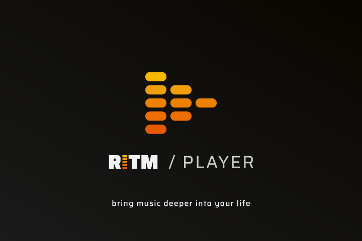

# RITM Player for Linux

**RITM Player** adalah pemutar audio bit-perfect modern yang dirancang khusus untuk rilisan album musik berformat `.ritm` dan berkas audio lossless di Linux.



## Fitur Unggulan (Linux Edition)

- **Bit-Perfect Native Audio Engine**: Mendukung akses langsung ke hardware audio/DAC melalui ALSA (`hw:` device) tanpa resampling OS, serta integrasi modern dengan PipeWire 0.3.
- **Dukungan Format Lengkap**: Dekoding native lossless FLAC & WAV, serta dukungan MP3, OGG, M4A, AAC via Web Audio fallback.
- **Distribusi Multi-Paket Linux**:
  - **RPM**: Untuk Fedora, Red Hat Enterprise Linux, openSUSE.
  - **DEB**: Untuk Ubuntu, Debian, Linux Mint, Pop!_OS.
  - **AppImage**: Paket portabel mandiri universal untuk semua distro Linux.
  - **tar.gz**: Ekstraksi portabel tanpa instalasi.
- **Integrasi Desktop Linux**: Asosiasi berkas `.ritm` otomatis, ikon standar tema freedesktop (hicolor), dan menu entry `.desktop`.
- **Fitur Kontainer RITM**: Verifikasi integritas digital (Ed25519 & SHA-256), visualizer lirik sinkron (karaoke vokal/instrumental), dan booklet interaktif.

---

## Cara Menjalankan & Membangun

### Persyaratan
- Linux x86_64 (Fedora 38+, Ubuntu 22.04+, Arch Linux, dll.)
- Node.js 22+ & npm
- Driver audio: ALSA (`alsa-lib` / `libasound2`) & PipeWire (`pipewire-libs` / `libpipewire-0.3`)

### Menjalankan di Mode Pengembangan
```bash
# Pasang dependensi
npm install

# Jalankan aplikasi Electron
npm start
```

### Mengompilasi Mesin Audio Native (ALSA & PipeWire)
```bash
cd ritm-desktop
npm run native:linux
```

### Membangun Paket Installer
```bash
cd ritm-desktop

# Paket RPM (Fedora, openSUSE, RHEL)
npm run dist:rpm

# Paket AppImage (Universal)
npm run dist:appimage

# Paket DEB (Ubuntu, Debian)
npm run dist:deb

# Bangun semua target paket sekaligus
npm run dist
```
Berkas installer akan dihasilkan di direktori `ritm-desktop/release/`.

---

© 2026 rieproject.id · Arie Jakawiguna
